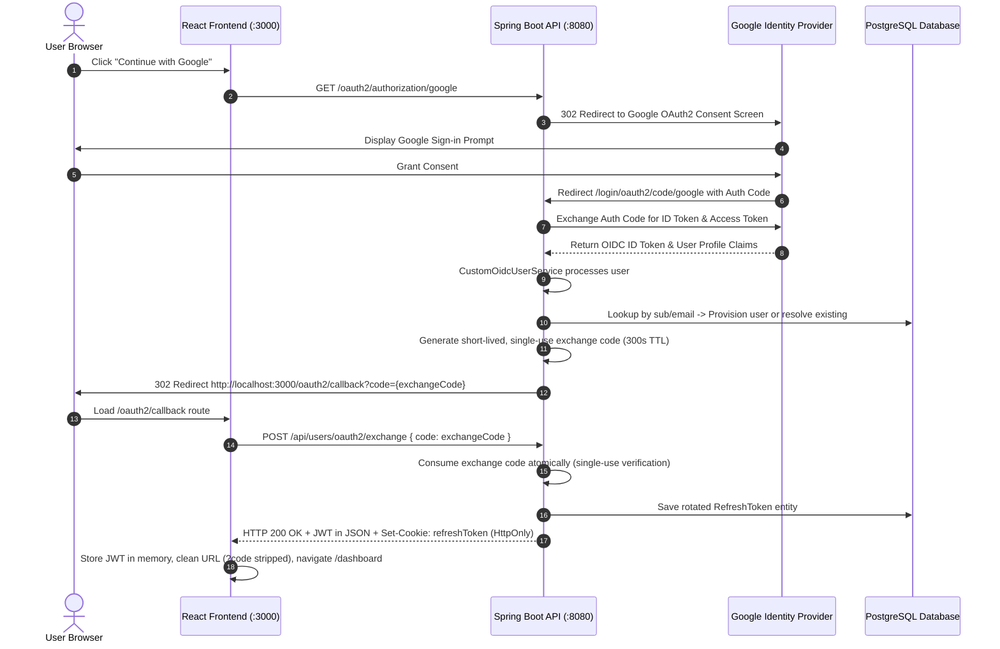

# 💰 ExpenseTracker — Full-Stack Financial Management Platform

A modern, production-ready expense tracking and financial analytics platform engineered with a **Java 21 / Spring Boot 3.4 REST API**, **PostgreSQL 16+**, and a **React 18 / TypeScript / Vite 6** frontend. Designed with enterprise architectural patterns including stateless JWT authentication, HttpOnly refresh token rotation, Google OAuth2 / OpenID Connect (OIDC) with single-use exchange codes, JPA auditing, and Flyway database migrations.

---

## 📑 Table of Contents

- [Key Features](#-key-features)
- [Screenshots](#-screenshots)
- [Technology Stack](#-technology-stack)
- [Architecture Overview](#-architecture-overview)
- [Project Directory Structure](#-project-directory-structure)
- [Prerequisites](#-prerequisites)
- [Local Development Setup](#-local-development-setup)
- [Environment Variables Configuration](#-environment-variables-configuration)
- [Database Setup & Migrations](#-database-setup--migrations)
- [Docker Compose Deployment](#-docker-compose-deployment)
- [API Documentation & Observability](#-api-documentation--observability)
- [Testing & Production Builds](#-testing--production-builds)
- [Security Architecture & Troubleshooting](#-security-architecture--troubleshooting)
- [Future Improvements (Roadmap)](#-future-improvements-roadmap)
- [License](#-license)

---

## ✨ Key Features

### 🔐 Authentication & Identity Management
- **Dual Authentication**: Support for both traditional email/password registration with BCrypt hashing and **Google OAuth2 / OpenID Connect (OIDC)** authentication.
- **In-Memory Access Tokens**: Short-lived JWT access tokens (15-minute lifespan) stored strictly in client memory to eliminate XSS token theft.
- **HttpOnly Refresh Token Rotation**: Long-lived refresh tokens (7-day lifespan) stored in secure, HttpOnly, SameSite cookies with database persistence and rotation on every renewal.
- **One-Time OAuth2 Exchange Code**: Single-use, cryptographically random authorization code exchange preventing token exposure in browser URLs.
- **Account Conflict Prevention**: Explicit detection and blocking when attempting to authenticate via OAuth with an email already bound to a local credentials account.
- **Email Verification**: Token-based email verification using Spring Mail with configurable token expiration and resend cooldowns.
- **Role-Based Access Control**: Granular endpoint authorization supporting `ROLE_USER` and `ROLE_ADMIN` using method-level `@PreAuthorize` security.

### 📊 Expense Management & Analytics
- **Full Expense Lifecycle**: Create, view, update, and soft-delete expenses scoped strictly to the authenticated user.
- **Structured Categorization**: Predefined financial categories (`FOOD`, `TRAVEL`, `SHOPPING`, `EDUCATION`, `ENTERTAINMENT`, `HEALTH`, `BILLS`, `OTHER`).
- **Pagination & Filtering**: Server-side pagination with rich metadata (`PagedResponse<T>`), category filtering, and ISO date-range parameters.
- **Aggregated Analytics**: Dedicated summary endpoint (`/api/expenses/summary`) providing total expenditure, category breakdowns, and monthly spending trends.
- **JPA Auditing & Soft Deletion**: Automated entity auditing (`createdAt`, `updatedAt`, `version`) and soft deletion (`@SQLDelete`, `@SQLRestriction`) to ensure data integrity.

### 💻 Modern Frontend Experience
- **Interactive UI**: Responsive, accessible interface built with Tailwind CSS, Lucide icons, and Framer Motion micro-interactions.
- **Visual Analytics**: Dynamic financial trend charts and distribution breakdowns powered by Recharts.
- **Data Synchronization**: Efficient server-state management, automated background refetching, and caching via TanStack React Query.
- **3D Visual Elements**: WebGL background visuals powered by Three.js and React Three Fiber.
- **Single-Origin Proxy**: Vite development proxy seamlessly routing `/api`, `/oauth2/authorization`, and `/login/oauth2` to bypass cross-origin cookie restrictions.

---

## 📸 Screenshots

> *Placeholder: Add screenshots of the user interface below before publishing publicly.*

| Dashboard & Overview | Financial Analytics |
| :---: | :---: |
|  |  |

| Expense Ledger & Modals | Authentication & Profile |
| :---: | :---: |
|  |  |

---

## 🛠️ Technology Stack

### Frontend
| Component | Technology | Version / Notes |
| :--- | :--- | :--- |
| **Framework** | React | 18.3 |
| **Language** | TypeScript | 5.6 |
| **Build Tool & Dev Server** | Vite | 6.0 |
| **Styling** | Tailwind CSS | 3.4 |
| **State Management** | Zustand | 5.0 (In-memory token & user state) |
| **Server State & Caching** | TanStack React Query | 5.62 |
| **HTTP Client** | Axios | 1.7 (Configured with `withCredentials: true`) |
| **Routing** | React Router | 6.28 |
| **Data Visualization** | Recharts | 2.15 |
| **Animation & 3D** | Framer Motion, Three.js, R3F | 11.15 / 0.186 |
| **Form Handling & Validation** | React Hook Form, Zod | 7.54 / 3.24 |
| **Icons** | Lucide React | 0.468 |

### Backend
| Component | Technology | Version / Notes |
| :--- | :--- | :--- |
| **Runtime** | Java Development Kit (JDK) | 21 (LTS) |
| **Framework** | Spring Boot | 3.4.3 |
| **Security** | Spring Security | 6.4 (Stateless JWT + OAuth2 Client + OIDC) |
| **JWT Library** | JJWT (io.jsonwebtoken) | 0.12.7 (HMAC-SHA256 signing) |
| **Persistence & ORM** | Spring Data JPA / Hibernate | 6.6 |
| **Connection Pooling** | HikariCP | Tuned production connection pool |
| **API Documentation** | SpringDoc OpenAPI / Swagger UI | 2.8.5 |
| **Observability** | Spring Boot Actuator, Micrometer | Prometheus metrics scraping |
| **Email Service** | Spring Boot Starter Mail | JavaMailSender with TLS support |
| **Boilerplate Reduction** | Project Lombok | Compile-time bytecode generation |

### Database & DevOps
| Component | Technology | Notes |
| :--- | :--- | :--- |
| **Primary Database** | PostgreSQL | 16+ (Local service or Docker container) |
| **Database Migrations** | Flyway | Versioned migrations (`V1` through `V4`) |
| **Integration Test DB** | H2 Database | Fast, in-memory PostgreSQL compatibility mode |
| **Containerization** | Docker, Multi-stage Dockerfile | Minimal Eclipse Temurin 21 JRE runtime image |
| **Orchestration** | Docker Compose | Multi-container setup (API, PostgreSQL, Adminer) |
| **CI Automation** | GitHub Actions | Automated build, test, and artifact packaging |

---

## 🏛️ Architecture Overview

The application follows a decoupled client-server architecture with strict single-origin proxying during development to satisfy browser cookie security standards (`HttpOnly; SameSite=Lax`).

```
+-----------------------------------------------------------------------------------+
|                                Browser / Client                                   |
|                          http://localhost:3000 (React SPA)                        |
+-----------------------------------------------------------------------------------+
       |                                      |                          ^
       | /oauth2/authorization/google         | /api/** (Axios)          | /oauth2/callback?code=...
       v                                      v                          |
+-----------------------------------------------------------------------------------+
|                        Vite Dev Server (Port 3000)                                |
|   Proxy Rules:                                                                    |
|     - /api                   -> http://localhost:8080/api                         |
|     - /oauth2/authorization -> http://localhost:8080/oauth2/authorization        |
|     - /login/oauth2          -> http://localhost:8080/login/oauth2                |
|     - /oauth2/callback       -> Local React SPA Route (index.html fallback)       |
+-----------------------------------------------------------------------------------+
                                      |
                                      v (Internal Proxied Traffic)
+-----------------------------------------------------------------------------------+
|                       Spring Boot 3.4 API (Port 8080)                             |
|   - SecurityFilterChain: Stateless JWT filter, CORS, Custom OAuth2/OIDC Handlers  |
|   - Controllers: /api/users, /api/expenses                                        |
|   - Services & Repositories: JPA Auditing, Soft Deletes                           |
+-----------------------------------------------------------------------------------+
                                      |
                                      v
+-----------------------------------------------------------------------------------+
|                       PostgreSQL 16/18 Database (Port 5432)                       |
|   - Database: expense_tracker (Managed via Flyway DDL migrations)                 |
+-----------------------------------------------------------------------------------+
```

### Google OAuth2 / OIDC One-Time Exchange Flow

To ensure JWT access tokens and refresh tokens are never exposed in browser address bars or URL history:



---

## 📁 Project Directory Structure

```text
expensetracker/
├── .github/
│   └── workflows/
│       └── ci.yml                     # GitHub Actions CI workflow
├── expensetracker/                    # Spring Boot 3.4 Backend
│   ├── .mvn/wrapper/                  # Maven wrapper binaries & properties
│   ├── src/
│   │   ├── main/
│   │   │   ├── java/com/example/expensetracker/
│   │   │   │   ├── config/            # Security, OpenAPI, Auditing, Properties
│   │   │   │   ├── controller/        # REST Controllers (ExpenseController, UserController)
│   │   │   │   ├── dto/               # Request, Response, and Envelope DTOs
│   │   │   │   ├── entity/            # JPA Entities (User, Expense, RefreshToken, etc.)
│   │   │   │   ├── exception/         # Custom exceptions & GlobalExceptionHandler
│   │   │   │   ├── repository/        # Spring Data JPA repositories
│   │   │   │   ├── security/          # JwtAuthenticationFilter & OAuth2/OIDC Services
│   │   │   │   └── service/           # Business logic services
│   │   │   └── resources/
│   │   │       ├── db/migration/      # Flyway SQL migrations (V1 to V4)
│   │   │       ├── application.properties
│   │   │       └── application.yml    # Main configuration with environment placeholders
│   │   └── test/
│   │       ├── java/com/example/expensetracker/ # Unit & integration test suites
│   │       └── resources/
│   │           └── application-test.yml # In-memory H2 test configuration
│   ├── mvnw                           # Linux/macOS Maven wrapper script
│   ├── mvnw.cmd                       # Windows PowerShell/CMD Maven wrapper script
│   └── pom.xml                        # Maven project descriptor & dependencies
├── frontend/                          # React 18 + Vite 6 Frontend
│   ├── src/
│   │   ├── components/                # Reusable UI components, modals, layout, layout shell
│   │   ├── hooks/                     # Custom TanStack React Query hooks
│   │   ├── pages/                     # SPA Pages (Dashboard, Expenses, Analytics, Login, etc.)
│   │   ├── services/api/              # Axios client, interceptors, and auth/expense endpoints
│   │   ├── store/                     # Zustand authentication state store
│   │   ├── types/                     # TypeScript domain models and API contracts
│   │   ├── utils/                     # Error handling and formatting utilities
│   │   ├── App.tsx                    # React Router configuration & provider setup
│   │   └── main.tsx                   # React DOM entry point
│   ├── package.json                   # NPM package manifest
│   ├── tailwind.config.js             # Tailwind CSS design system configuration
│   ├── tsconfig.json                  # TypeScript compiler configuration
│   └── vite.config.ts                 # Vite dev server configuration & reverse proxy
├── .env.example                       # Local environment configuration template
├── .gitignore                         # Git exclusion rules
├── AGENTS.md                          # Development environment documentation
├── Dockerfile                         # Multi-stage production container build
├── docker-compose.yml                 # Orchestration for API, PostgreSQL, and Adminer
├── README.md                          # Project documentation
└── render.yaml                        # Infrastructure-as-code deployment blueprint
```

---

## 📋 Prerequisites

Ensure the following tools are installed on your machine before running locally:

- **Java Development Kit (JDK)**: Version **21** (Eclipse Temurin 21 recommended)
- **Node.js**: Version **18.x** or higher (tested on Node.js 22 LTS)
- **Package Manager**: **npm** (v10+)
- **Database**: **PostgreSQL 16+** running locally on port `5432` OR **Docker**
- **Docker & Docker Compose** *(Optional)*: Version 24+ for containerized execution

---

## 🚀 Local Development Setup

Follow these steps to run the application natively on Windows using PowerShell.

### 1. Clone Repository & Setup Environment Template

```powershell
git clone https://github.com/<your-username>/ExpenseTrackerAPI.git
cd ExpenseTrackerAPI

# Copy environment template to a local, untracked .env file
Copy-Item .env.example .env
```

> [!IMPORTANT]
> The `.env` file contains sensitive values and is explicitly excluded by `.gitignore`. Never commit `.env` or plain-text secrets to version control.

### 2. Configure Local PostgreSQL Database

Ensure PostgreSQL is running locally on port `5432`. Create the target database using `psql` or pgAdmin:

```sql
CREATE DATABASE expense_tracker;
```

### 3. Start the Backend API (Spring Boot)

Open a PowerShell terminal and set your local environment variables:

```powershell
cd expensetracker

# Set environment variables for the current PowerShell session
$env:DB_HOST="localhost"
$env:DB_PORT="5432"
$env:DB_NAME="expense_tracker"
$env:DB_USERNAME="postgres"
$env:DB_PASSWORD="your_postgres_password"

# Generate a strong 64-hex-char JWT Secret or provide your own
$env:JWT_SECRET="404E635266556A586E3272357538782F413F4428472B4B6250645367566B5970"

# Optional: Google OAuth2 Credentials (required for Google Login button)
$env:GOOGLE_CLIENT_ID="your-client-id.apps.googleusercontent.com"
$env:GOOGLE_CLIENT_SECRET="your-client-secret"

# Launch Spring Boot via Maven wrapper
.\mvnw.cmd spring-boot:run
```

The backend starts on `http://localhost:8080`. Flyway automatically executes database migrations on startup.

### 4. Start the Frontend Application (React / Vite)

Open a second PowerShell terminal:

```powershell
cd frontend

# Install dependencies
npm install

# Start Vite development server
npm run dev
```

The frontend dev server starts on `http://localhost:3000`.

Open your browser and navigate to **[http://localhost:3000](http://localhost:3000)**.

---

## ⚙️ Environment Variables Configuration

The application reads its configuration from system environment variables with sensible defaults defined in `application.yml` and `vite.config.ts`.

| Variable | Description | Default / Example | Required |
| :--- | :--- | :--- | :---: |
| `DB_HOST` | Hostname of the PostgreSQL database | `localhost` | No |
| `DB_PORT` | Port of the PostgreSQL database | `5432` | No |
| `DB_NAME` | Name of the database | `expense_tracker` | No |
| `DB_USERNAME` | PostgreSQL username | `postgres` | No |
| `DB_PASSWORD` | PostgreSQL password | *None* | **Yes** |
| `JWT_SECRET` | 256-bit hexadecimal string for HMAC-SHA signing | `404E6352...` *(Change in prod)* | **Yes** |
| `JWT_ACCESS_EXPIRATION_MS` | Access token lifespan in milliseconds | `900000` (15 minutes) | No |
| `JWT_REFRESH_EXPIRATION_MS`| Refresh token lifespan in milliseconds | `604800000` (7 days) | No |
| `COOKIE_SECURE` | Set `true` in production to enforce HTTPS cookie delivery | `false` | No |
| `COOKIE_SAME_SITE` | Cookie SameSite policy (`Lax`, `Strict`, `None`) | `Lax` | No |
| `GOOGLE_CLIENT_ID` | Google OAuth2 Client ID from Google Cloud Console | *None* | For OAuth |
| `GOOGLE_CLIENT_SECRET` | Google OAuth2 Client Secret | *None* | For OAuth |
| `APP_FRONTEND_URL` | Frontend URL for email verification links | `http://localhost:3000` | No |
| `OAUTH2_REDIRECT_URI` | Frontend callback redirect URL after Google sign-in | `http://localhost:3000/oauth2/callback` | No |
| `OAUTH2_FAILURE_REDIRECT_URI` | Frontend redirect URL on OAuth failure | `http://localhost:3000/login?error=oauth_failed` | No |
| `OAUTH2_EXCHANGE_EXPIRATION_SECONDS` | Lifespan of single-use OAuth exchange code | `300` (5 minutes) | No |
| `MAIL_HOST` | SMTP server host | `localhost` | For Email |
| `MAIL_PORT` | SMTP server port | `587` | For Email |
| `MAIL_USERNAME` | SMTP authentication username | *None* | For Email |
| `MAIL_PASSWORD` | SMTP authentication password / app token | *None* | For Email |
| `VITE_API_BASE_URL` | Frontend API base path (proxied) | `/api` | No |
| `BACKEND_URL` | Target backend URL for Vite reverse proxy | `http://localhost:8080` | No |

### Google Cloud OAuth Configuration

To enable Google sign-in, configure an OAuth 2.0 Client ID in **Google Cloud Console** under **APIs & Services > Credentials**:

- **Application Type**: Web application
- **Authorized JavaScript origins**:
  - `http://localhost:3000`
  - `http://localhost:8080`
- **Authorized redirect URIs**:
  - `http://localhost:8080/login/oauth2/code/google`
  - `http://localhost:3000/login/oauth2/code/google`

---

## 🗄️ Database Setup & Migrations

Database schema management is handled automatically by **Flyway**. Manual DDL execution is not required.

### Migration History
- **`V1__init_schema.sql`**: Initial DDL creating `users`, `expenses`, `refresh_tokens`, indexes, and auditing columns.
- **`V2__upgrade_existing_schema.sql`**: Schema hardening, optimistic locking `version` columns, and soft deletion flags.
- **`V3__add_oauth_support.sql`**: Adds `auth_provider` and `provider_id` columns; relaxes null constraints on passwords for OAuth users.
- **`V4__add_email_verification.sql`**: Creates `email_verification_tokens` table and adds `email_verified` flag to `users`.

Flyway runs automatically upon Spring Boot application startup with:
```yaml
spring.flyway.baseline-on-migrate: true
spring.flyway.validate-on-migrate: false
```

---

## 🐳 Docker Compose Deployment

The repository includes a production-ready `docker-compose.yml` that provisions the Spring Boot API, PostgreSQL 16 database, and Adminer web interface.

### Running with Docker Compose

1. Set the required credentials in your local shell:

```powershell
$env:DB_PASSWORD="your_secure_postgres_password"
$env:JWT_SECRET="your_strong_jwt_secret_key"
$env:GOOGLE_CLIENT_ID="your_google_client_id"
$env:GOOGLE_CLIENT_SECRET="your_google_client_secret"
```

2. Build and launch the container stack:

```powershell
docker compose up --build -d
```

### Container Endpoints

| Service | Local Address | Description |
| :--- | :--- | :--- |
| **Spring Boot API** | [http://localhost:8080](http://localhost:8080) | Containerized REST API |
| **PostgreSQL 16** | `localhost:5432` | Containerized database (`expense_tracker`) |
| **Adminer Web GUI** | [http://localhost:8081](http://localhost:8081) | Database administration web interface |

To stop the containers without destroying volume data:
```powershell
docker compose down
```

---

## 📖 API Documentation & Observability

### Interactive Documentation & Observability Endpoints

When the backend is running, the following endpoints are available:

- **Swagger UI**: [http://localhost:8080/swagger-ui.html](http://localhost:8080/swagger-ui.html)
- **OpenAPI 3 JSON Specification**: [http://localhost:8080/v3/api-docs](http://localhost:8080/v3/api-docs)
- **Spring Boot Actuator Health**: [http://localhost:8080/actuator/health](http://localhost:8080/actuator/health)
- **Prometheus Metrics**: [http://localhost:8080/actuator/prometheus](http://localhost:8080/actuator/prometheus)

### Summary of REST API Endpoints

#### Authentication & User Management (`/api/users`)
| Method | Endpoint | Description | Auth Required |
| :--- | :--- | :--- | :---: |
| `POST` | `/api/users/register` | Register new local user account | No |
| `POST` | `/api/users/login` | Authenticate with email & password | No |
| `POST` | `/api/users/oauth2/exchange` | Exchange single-use OAuth code for JWT | No |
| `POST` | `/api/users/refresh-token` | Rotate refresh token cookie and issue new JWT | No |
| `POST` | `/api/users/logout` | Revoke refresh token and invalidate cookie | No |
| `GET` | `/api/users/verify-email` | Validate email verification token | No |
| `POST` | `/api/users/resend-verification` | Resend email verification link | No |
| `GET` | `/api/users/me` | Retrieve authenticated user profile | **Yes** |
| `PUT` | `/api/users/{id}` | Update profile name and email | **Yes** |
| `PUT` | `/api/users/{id}/password` | Update account password | **Yes** |
| `DELETE` | `/api/users/{id}` | Delete account and associated data | **Yes** |
| `GET` | `/api/users` | List all registered users | **Admin** |
| `PATCH` | `/api/users/{id}/role` | Update user authorization role | **Admin** |

#### Expense Management (`/api/expenses`)
| Method | Endpoint | Description | Auth Required |
| :--- | :--- | :--- | :---: |
| `POST` | `/api/expenses` | Create a new expense | **Yes** |
| `GET` | `/api/expenses` | Paginated expenses with category & date filters | **Yes** |
| `GET` | `/api/expenses/{id}` | Get single expense details by ID | **Yes** |
| `PUT` | `/api/expenses/{id}` | Update an existing expense | **Yes** |
| `DELETE` | `/api/expenses/{id}` | Soft-delete an expense record | **Yes** |
| `GET` | `/api/expenses/my-expenses` | Retrieve complete expense list | **Yes** |
| `GET` | `/api/expenses/summary` | Aggregated analytics & category breakdown | **Yes** |

#### Google OAuth2 & OpenID Connect
| Method | Endpoint | Description | Auth Required |
| :--- | :--- | :--- | :---: |
| `GET` | `/oauth2/authorization/google` | Initiate Google OAuth2 authorization flow | No |
| `GET` | `/login/oauth2/code/google` | Google callback handled by Spring Security | No |
| `GET` | `/oauth2/callback` | Frontend SPA route on port 3000 | No |

---

## 🧪 Testing & Production Builds

### Backend Testing & Build (Maven)

The backend test suite uses **JUnit 5**, **Mockito**, and an in-memory **H2 database** (in PostgreSQL compatibility mode). Tests run independently of any external PostgreSQL instance.

```powershell
cd expensetracker

# Run full backend test suite (52 tests across security, services, controllers)
.\mvnw.cmd test

# Compile all source files
.\mvnw.cmd compile

# Package production executable JAR (skipping test execution)
.\mvnw.cmd clean package -DskipTests
```

### Frontend Testing & Build (Vite)

```powershell
cd frontend

# Run TypeScript type check and build production distribution bundle
npm run build

# Preview local production build
npm run preview
```

---

## 🔒 Security Architecture & Troubleshooting

### Defense-in-Depth Token Security
1. **No Tokens in LocalStorage**: JWT access tokens are stored strictly in memory via Zustand and never written to `localStorage` or `sessionStorage`.
2. **HttpOnly Cookie Protection**: Refresh tokens cannot be read or exfiltrated by client-side JavaScript, neutralizing Cross-Site Scripting (XSS) attack vectors.
3. **No Tokens in URLs**: OAuth authorization redirects use an ephemeral, single-use exchange code that expires after 5 minutes and is immediately invalidated upon first consumption.
4. **Account Hijacking Prevention**: If an account was registered with email/password, a Google OAuth login using the same email is refused (`account_conflict`) rather than silently merged.

### Common Troubleshooting Scenarios

#### 1. `NoResourceFoundException: No static resource oauth2/callback`
- **Cause**: The Vite proxy rule in `frontend/vite.config.ts` was matching `/oauth2` broadly and forwarding the frontend SPA callback route to Spring Boot.
- **Solution**: Verify `vite.config.ts` proxies `/oauth2/authorization` specifically, allowing `/oauth2/callback` to be handled by React Router.

#### 2. `Invalid or expired OAuth2 exchange code`
- **Cause**: Exchange codes are single-use with a 300-second TTL. Reloading `/oauth2/callback` or React StrictMode triggering duplicate calls will cause a 401.
- **Solution**: The frontend callback page automatically sanitizes the browser URL via `window.history.replaceState` upon receipt, preventing re-submission on reload.

#### 3. `Connection to localhost:5432 refused`
- **Cause**: PostgreSQL service is stopped or running on a non-standard port.
- **Solution**: Run `Get-Service *postgres*` in PowerShell to ensure the Windows service is running, or verify your `DB_PORT` setting.

#### 4. Google OAuth `redirect_uri_mismatch`
- **Cause**: The redirect URI registered in Google Cloud Console does not match the URI sent by Spring Security.
- **Solution**: Ensure `http://localhost:8080/login/oauth2/code/google` is added to **Authorized redirect URIs** in your Google Cloud credentials.

---

## 🗺️ Future Improvements (Roadmap)

The following features are planned for future iterations of ExpenseTracker:

- [ ] **Multi-Currency Support**: Real-time currency conversion and multi-currency expense logging.
- [ ] **Receipt OCR Scanning**: Automatic extraction of merchant name, date, and amount from receipt images.
- [ ] **Recurring Subscriptions**: Automated expense generation for periodic subscription services.
- [ ] **Export to CSV & PDF**: Downloadable expense statements and tax reports.
- [ ] **Budget Threshold Alerts**: Real-time email notifications when category budgets exceed preset limits.

---

## 📄 License

Licensing terms have not yet been specified for this project. Please contact the repository owner regarding distribution, modification, and commercial usage rights.
